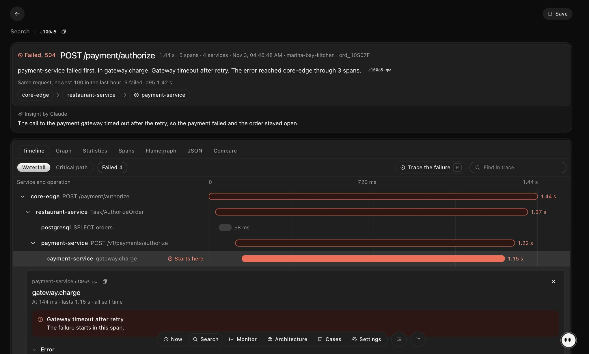
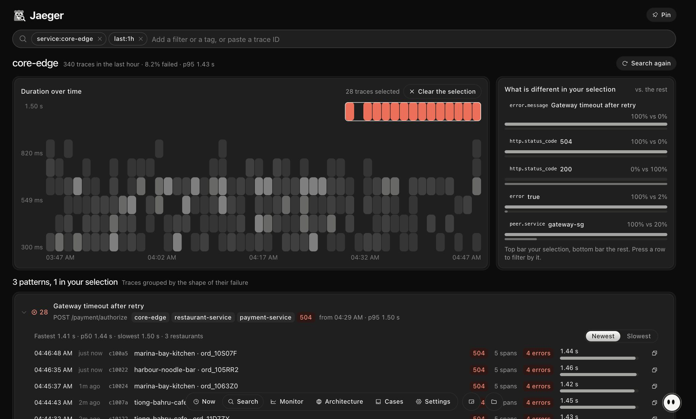
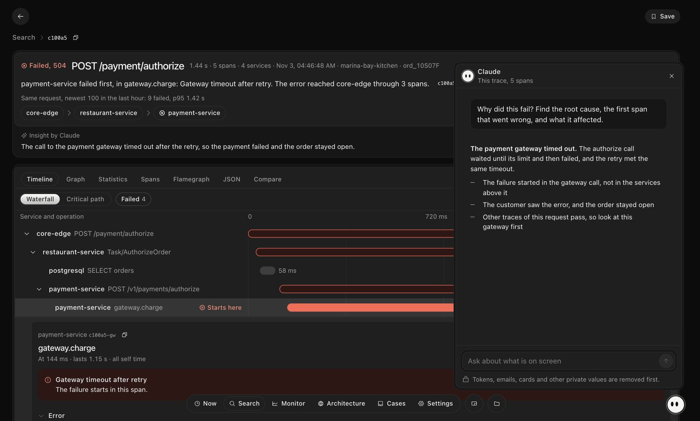
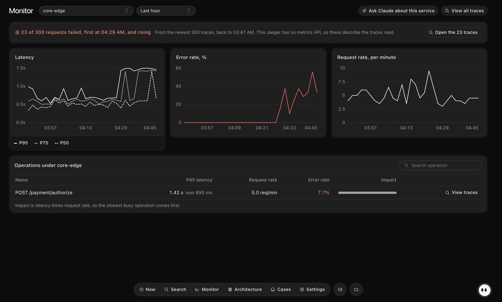
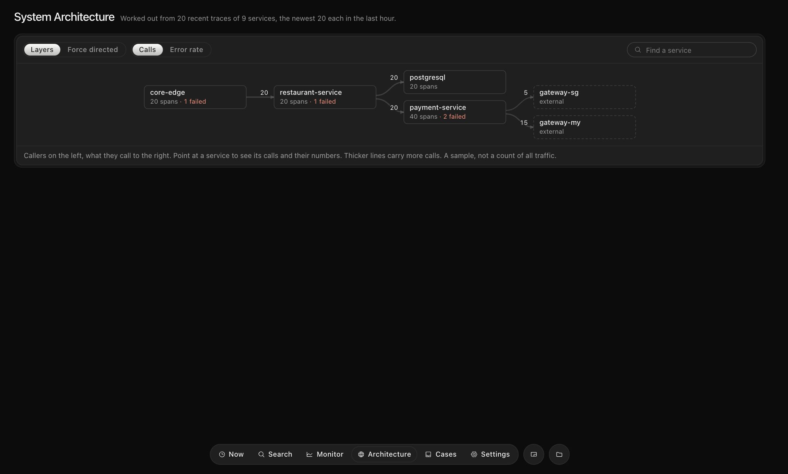

# Jaeger Toolkit 2

**The Jaeger tab, rebuilt.** A Chrome extension for your team's Jaeger: a verdict on every trace, the path a failure took, and Claude beside it.

[Download page](https://arshadaiyoob.github.io/jaeger-toolkit-v2-releases/) · [Releases](https://github.com/arshadaiyoob/jaeger-toolkit-v2-releases/releases) · [Version 1](https://arshadaiyoob.github.io/jaeger-toolkit-releases/)

<picture>
  <source media="(prefers-color-scheme: light)" srcset="docs/shots/trace-light.jpg">
  
</picture>

> Screenshots use sample traces.

## What it does

- **A verdict on every trace.** One sentence says what failed and where it began, before any spans.
- **Claude beside it.** Ask about what's on screen, search in plain words, and get short insights on failed traces, with an API key or Claude Code.
- **Search as a picture.** Failures stand out over time, and traces group by the shape of their failure.
- **Monitor and architecture from traces.** Works where Jaeger has no metrics or dependency data.
- **Cases.** Keep the traces of one problem together, with notes, after they age out of Jaeger.
- **Your links keep working.** It takes over the Jaeger tab at the same addresses, and classic Jaeger is one press away.
- **Private by default.** Keys you choose are never sent to Claude, and emails and phone numbers are masked.

<table>
<tr>
<td width="50%"><strong>Search</strong><br></td>
<td width="50%"><strong>Claude</strong><br></td>
</tr>
<tr>
<td><strong>Monitor</strong><br></td>
<td><strong>Architecture</strong><br></td>
</tr>
</table>

## Install

There's no release yet. When there is, it will appear under [Releases](https://github.com/arshadaiyoob/jaeger-toolkit-v2-releases/releases) and on the [download page](https://arshadaiyoob.github.io/jaeger-toolkit-v2-releases/).

1. Download the release and unzip it somewhere it can stay.
2. Open `chrome://extensions`, turn on Developer mode, press **Load unpacked** and choose the folder.
3. To use Claude Code or automatic updates, run this once from inside the folder (needs Node.js), then reload the extension:

   ```sh
   sh native-host/install.sh
   ```

4. Open Jaeger. A short welcome shows the way round.

Works in Chrome, Dia, Arc, Brave, Edge and other Chromium browsers.

## Updates and trust

This repository holds the built releases and the download page. The source is private.

The toolkit checks for a new version when the browser starts and once a day. The helper installs only what is signed with the release key, after checking its size and SHA-256.

Jaeger Toolkit is not part of the Jaeger project.
